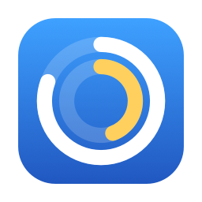

<div align="center">



# Ringwise

**Your disk, ring by ring.**
A fast, native, open-source disk-space analyzer for macOS with a Liquid Glass interface.

**English** · [繁體中文](README.zh-Hant.md) · [简体中文](README.zh-Hans.md)

[](LICENSE)


</div>

<!-- Screenshots: docs/images/*.png -->

## Features

- **Fast full-disk scan.** A parallel `getattrlistbulk` scanner reads about 4.6 million files in roughly 20 seconds. Results appear in a responsive UI that never freezes.
- **Sunburst chart.** Three rings show the current folder at a glance. Hover to inspect, click to drill in, click the center to go up. Colors match the table and legend.
- **Analysis views:**
  - **Apps:** what each app really takes, counting the app bundle plus its data, caches and containers. Also flags leftovers from apps you already uninstalled.
  - **File types:** video, photos, disk images, archives, developer caches and more.
  - **Cleanup:** rule-based suggestions (app caches, Xcode DerivedData, simulators, npm/pnpm caches, stale `node_modules`, old installers…), each with a safety level.
  - **Large files** and instant **search** across everything.
- **Safe by design.** Items only ever go to the Trash after you confirm, and protected system locations can't be removed.
- **Multi-select mode.** Pick many items with plain clicks. A floating glass bar shows how much space you'll free.
- **Ask AI (optional).** "What is this, and can I delete it?"
  - Uses Apple's on-device model, or an AI CLI you already use (Claude Code, Codex, Antigravity, opencode).
  - Sends only names, paths, sizes and dates, never file contents, and only after you explicitly agree.
- **Localized** in Traditional Chinese, Simplified Chinese and English. More languages are welcome via [Crowdin](docs/TRANSLATING.md).
- **Private.** No analytics, no telemetry, no network requests of its own. See the [privacy policy](docs/PRIVACY.md).

## Requirements

- macOS 26 (Tahoe) or later
- Apple Silicon or Intel Mac

## Install

- **Mac App Store:** coming soon.
- **Direct download:** grab the DMG from [Releases](https://github.com/PGpenguin72/Ringwise/releases) and drag Ringwise to Applications.
- For complete results, enable **System Settings › Privacy & Security › Full Disk Access** for Ringwise.

The App Store version is sandboxed, so the first time you scan the whole disk it asks you to select "Macintosh HD". Its AI feature uses Apple's on-device model only.

## Build from source

```bash
git clone https://github.com/PGpenguin72/Ringwise.git
cd Ringwise
swift build                 # build
swift test                  # run tests
./scripts/build-app.sh      # create dist/Ringwise.app
open dist/Ringwise.app
```

For signed builds (Developer ID or App Store), generate the Xcode project with [XcodeGen](https://github.com/yonaskolb/XcodeGen):

```bash
brew install xcodegen
xcodegen generate
open Ringwise.xcodeproj     # schemes: Ringwise (direct) and Ringwise-AppStore
```

Requires Xcode 26 or later.

## How the AI feature works

1. Select items and click **Ask AI** (or right-click › 問 AI).
2. The first time, Ringwise shows which tool it will run and previews the exact text it will send. Nothing happens until you click **Agree**.
3. The tool runs read-only, with no tools allowed, in an empty temporary folder. Its answer is shown with a safety badge and is cached locally.

Supported providers:

- **Apple on-device model** (Apple Intelligence). Offline, free, private.
- [Claude Code](https://claude.com/claude-code), [Codex](https://github.com/openai/codex), Antigravity (`agy`), [opencode](https://opencode.ai) and Gemini CLI. These are available in the direct-download build only, and they use your own account with that vendor.

## Contributing

Issues and pull requests are welcome. Please read [CONTRIBUTING.md](CONTRIBUTING.md). If you use an AI coding agent, point it at [AGENTS.md](AGENTS.md). To help translate, see [docs/TRANSLATING.md](docs/TRANSLATING.md).

## License

[MIT](LICENSE) © 2026 PGpenguin72 · [Privacy Policy](docs/PRIVACY.md) · [Terms of Use](docs/TERMS.md)

Ringwise is an independent project. It is not affiliated with Apple, Anthropic, OpenAI or Google.
